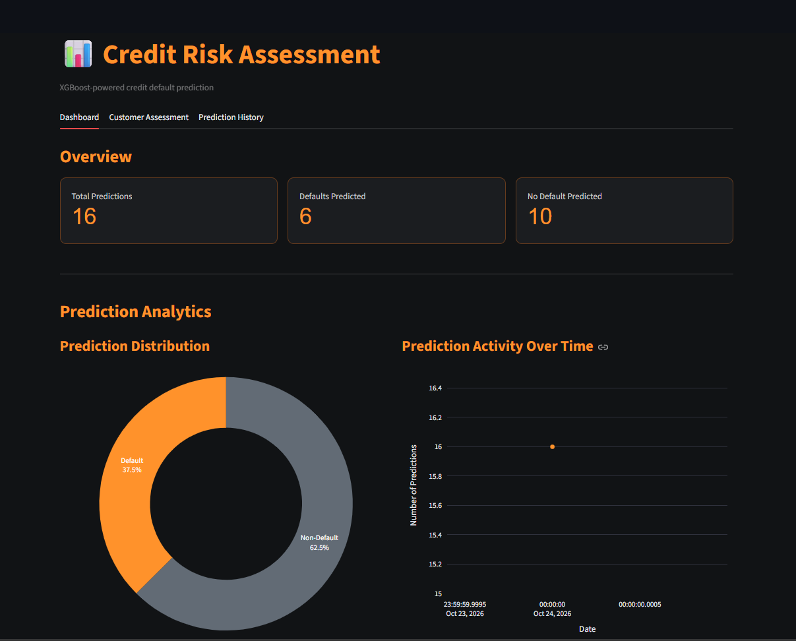
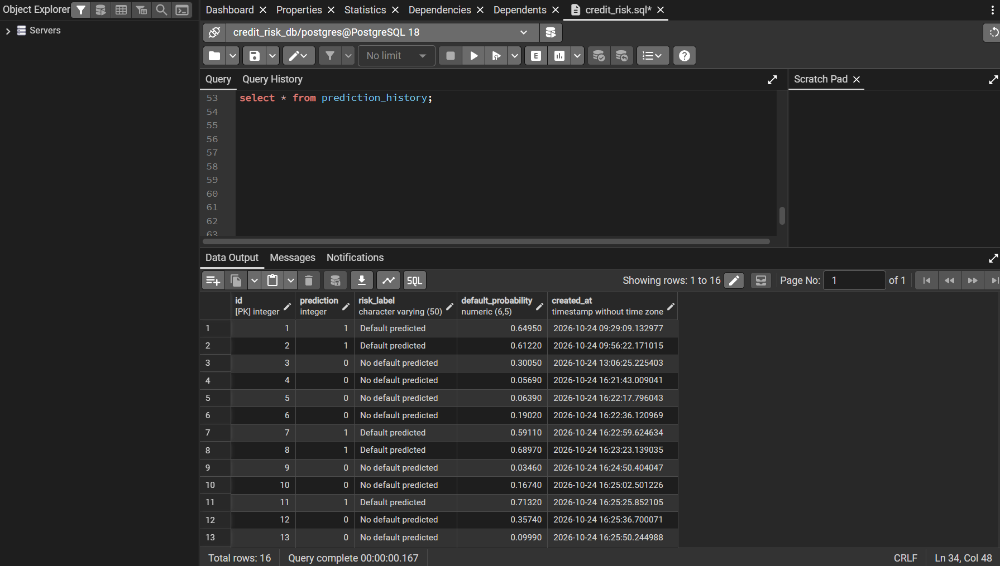
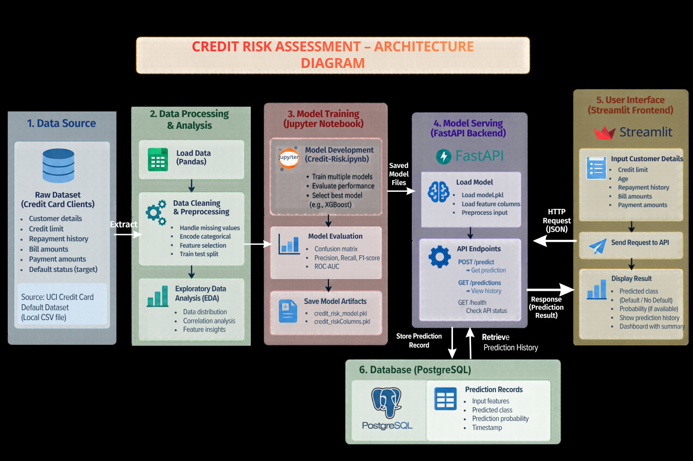

<<<<<<< HEAD
# Credit Risk Assessment & Default Prediction
A machine learning web application that predicts whether a credit card customer may default on their next payment.
## 🚀 Features
- Credit default prediction using Machine Learning
- Interactive dashboard built with Streamlit
- REST API built using FastAPI
- PostgreSQL database for storing prediction history
- Data analysis and model training using Python
## 🛠️ Tech Stack
- Python, Pandas, NumPy, Scikit-learn, XGBoost
- FastAPI
- Streamlit
- PostgreSQL
- Jupyter Notebook
## 📂 Project Structure
- `backend/` – FastAPI backend and database connection
- `frontend/` – Streamlit application
- `artifacts/` – Saved ML model files
- `notebook/` – Data analysis and model training
- `Data/` – Processed dataset
## ▶️ Run Locally
**1. Install dependencies**
```bash
pip install -r requirements.txt
```
**2. Start the backend**
```bash
uvicorn backend.app.main:app --reload
```
**3. Start the frontend in another terminal**
```bash
streamlit run frontend/app.py
```
Configure PostgreSQL and the backend API URL before running the application.
## 📊 Dataset
Uses historical credit card client data to predict the target `default payment next month` (0 = No Default, 1 = Default).
## ⚠️ Disclaimer
This project is for educational and portfolio purposes only. Predictions are not financial advice and are not validated for real-world lending decisions.
## 👨‍💻 Author
**Rudraksha Gupta**  
Electrical Engineering Student | MNIT Jaipur
Interested in Data Science, Machine Learning, and Data Analytics.
=======
# Credit Risk Assessment & Default Prediction
A machine learning web application that predicts whether a credit card customer may default on their next payment.
## 🚀 Features
- Credit default prediction using Machine Learning
- Interactive dashboard built with Streamlit
- REST API built using FastAPI
- PostgreSQL database for storing prediction history
- Data analysis and model training using Python
## 🛠️ Tech Stack
- Python, Pandas, NumPy, Scikit-learn, XGBoost
- FastAPI
- Streamlit
- PostgreSQL
- Jupyter Notebook
## 📂 Project Structure
- `backend/` – FastAPI backend and database connection
- `frontend/` – Streamlit application
- `artifacts/` – Saved ML model files
- `notebook/` – Data analysis and model training
- `Data/` – Processed dataset
## ▶️ Run Locally
**1. Install dependencies**
```bash
pip install -r requirements.txt
```
**2. Start the backend**
```bash
uvicorn backend.app.main:app --reload
```
**3. Start the frontend in another terminal**
```bash
streamlit run frontend/app.py
```
Configure PostgreSQL and the backend API URL before running the application.
## 📊 Dataset
Uses historical credit card client data to predict the target `default payment next month` (0 = No Default, 1 = Default).
## ⚠️ Disclaimer
This project is for educational and portfolio purposes only. Predictions are not financial advice and are not validated for real-world lending decisions.
## 👨‍💻 Author
**Rudraksha Gupta**  
Electrical Engineering Student | MNIT Jaipur
Interested in Data Science, Machine Learning, and Data Analytics.

## 📸 Project Screenshots




>>>>>>> 0265238 (Update README with project screenshots)
